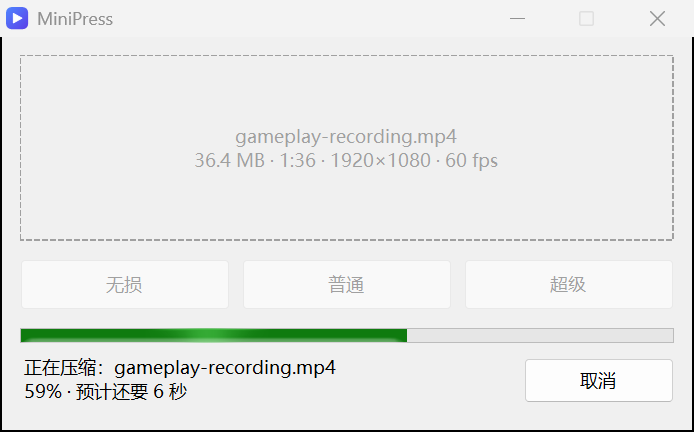
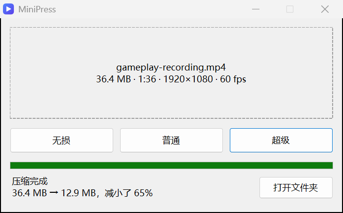
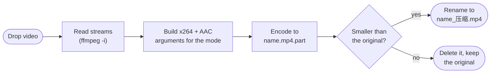

<div align="center">


# MiniPress

**Drop a video in. Click once. Get a file small enough to share.**

A no-install video compressor for Windows: one 5&nbsp;MB `.exe` with FFmpeg built in.

[](https://github.com/iDucklinqz/MiniPress/releases/latest)
[](https://github.com/iDucklinqz/MiniPress/releases)

[](LICENSE)

### [⬇&nbsp; Download MiniPress.exe](https://github.com/iDucklinqz/MiniPress/releases)

English · [简体中文](README.zh-CN.md)

<br>

&nbsp;


</div>

<br>

## Why MiniPress

Screen recorders and phones write huge files. Most chat apps and email won't take them, and full video editors have far too many settings for a quick share. MiniPress has three buttons.

|  |  |
|---|---|
| 📦 **One file, nothing to install** | FFmpeg is compiled into the `.exe`. Copy it to any Windows 10/11 PC and double-click it. |
| 🎚️ **Three modes, no settings** | Lossless, Normal or Super. Pick one and compression starts. |
| 🛡️ **Your original is never touched** | The result is saved next to the original. If it would come out *bigger*, MiniPress discards it and keeps only your original. |
| 🗂️ **Batch friendly** | Drop several videos, or a whole folder, at once. |
| ▶️ **Plays everywhere** | Every output is an H.264 + AAC MP4 that plays on phones, browsers and chat apps. |
| 🔒 **Offline** | The built-in FFmpeg is compiled without network support. Nothing is uploaded. |

> [!NOTE]
> The interface is in Simplified Chinese. The three buttons are **无损** (Lossless), **普通** (Normal) and **超级** (Super).

## Quick start

1. [Download `MiniPress.exe`](https://github.com/iDucklinqz/MiniPress/releases). That is the whole program.
2. Double-click it.
3. Drag a video onto the window (or click the window to choose files, or drop files onto the `.exe` itself).
4. Click a mode. **普通 / Normal** suits most videos.

The result appears beside the original as `name_压缩.mp4`. Click **打开文件夹** (Open folder) to jump to it.

> [!TIP]
> In one test, a 96-second 1080p60 screen recording went from **150 MB to 36 MB** in Normal mode with no visible loss in quality.

## Modes

| Button | Mode | Video | Resolution · frame rate | Audio | Best for |
|:---:|---|---|---|---|---|
| **无损** | Lossless&nbsp;¹ | H.264, CRF 18 | unchanged | AAC kept as is, otherwise 192 kbps | archiving |
| **普通** | **Normal** ⭐ | H.264, CRF 26 | unchanged | AAC ≤ 160 kbps kept, otherwise 128 kbps | everyday sharing |
| **超级** | Super | H.264, CRF 28 | shorter side ≤ 720 px · ≤ 30 fps | AAC ≤ 120 kbps kept, otherwise 96 kbps stereo | chat apps with size limits |

¹ *Visually* lossless: you can't see the difference. Mathematically lossless encoding would make most videos **larger** than the original, which defeats the purpose.

All modes use x264's `slow` preset. Portrait videos stay portrait, and rotated phone videos are turned upright.

## Supported input

| | |
|---|---|
| **Containers** | MP4 · MOV · MKV · WebM · AVI · WMV/ASF · FLV · TS/MTS/M2TS · MPG/VOB · RM/RMVB · 3GP · OGV |
| **Video** | H.264 · H.265/HEVC · AV1 · VP8/VP9 · MPEG-1/2/4 · WMV 7/8/9 · VC-1 · RealVideo · Theora · MJPEG · ProRes · DNxHD |
| **Screen-recording codecs** | FFV1 · UtVideo · HuffYUV · MagicYUV · Fraps · QuickTime Animation |
| **Audio** | AAC · MP3 · Opus · Vorbis · FLAC · ALAC · AC-3/E-AC-3 · DTS · WMA · PCM · AMR · RealAudio |

## FAQ

<details>
<summary><b>Windows says “Windows protected your PC”. Is it safe?</b></summary>
<br>

MiniPress isn't code-signed, so SmartScreen warns about any new download. Click **More info → Run anyway**. You can review every line of source in this repository and rebuild the `.exe` yourself (see [Building from source](#building-from-source)).
</details>

<details>
<summary><b>Where does the compressed file go?</b></summary>
<br>

It goes next to the original, named `name_无损压缩.mp4`, `name_压缩.mp4` or `name_超级压缩.mp4` depending on the mode. Existing files are never overwritten: MiniPress adds ` (2)`, ` (3)` and so on. If the original's folder is read-only, the result goes to your **Videos** folder.
</details>

<details>
<summary><b>Why was my video “skipped”?</b></summary>
<br>

The compressed result came out no smaller than the original, which happens with videos that are already well compressed. MiniPress throws that result away and keeps only your original. Try **超级 / Super** for a smaller file.
</details>

<details>
<summary><b>What does MiniPress write to my PC?</b></summary>
<br>

On first launch, it unpacks its built-in FFmpeg (≈ 14 MB) to `%LOCALAPPDATA%\MiniPress`. This takes under a second, and later launches reuse that copy. It writes no registry entries and installs no services. To remove every trace, delete that folder and the `.exe`.
</details>

<details>
<summary><b>How fast is it?</b></summary>
<br>

On a modern laptop, a 1080p60 video compresses at about 3× real time: one minute of video takes about 20 seconds. MiniPress runs FFmpeg at below-normal priority so your PC stays responsive, and keeps the PC from sleeping until compression finishes. Press <kbd>Esc</kbd> or **取消** (Cancel) to stop. The partly written file is then deleted.
</details>

## How it works



MiniPress is a small WinForms app (C# 5, .NET Framework 4.8, which is built into Windows 10/11). The FFmpeg inside it is a minimal static build containing only the decoders, filters and encoders MiniPress uses. It is 14 MB instead of 200+ MB for a full build, and it depends only on DLLs that ship with Windows.

## Building from source

MiniPress builds with the C# compiler that ships with Windows. No Visual Studio or .NET SDK is needed.

**1. Build the minimal FFmpeg** (only needed once, or when upgrading FFmpeg)

In an [MSYS2](https://www.msys2.org) **UCRT64** shell:

```bash
pacman -S mingw-w64-ucrt-x86_64-{gcc,nasm,pkgconf,dav1d} make diffutils
# place official ffmpeg-7.1.2.tar.xz and x264-stable.tar.bz2 into ./sources (see the script header)
tools/build-ffmpeg.sh ./sources ./work
cp work/ffmpeg.exe assets/ffmpeg.exe
```

**2. Build MiniPress**

```powershell
powershell -ExecutionPolicy Bypass -File build.ps1
```

This produces `dist\MiniPress.exe`, which takes a few seconds. Use `build.ps1 -NoFFmpeg` for a 140 KB development build that uses an `ffmpeg.exe` already installed on your PC instead.

<details>
<summary><b>Project layout</b></summary>
<br>

| Path | What's inside |
|---|---|
| `src/FFmpeg.cs` | Unpacking the built-in FFmpeg, reading stream info, mode → arguments, running an encode with progress |
| `src/MainForm.cs` | The window: drag & drop, batch queue, progress, results |
| `src/Controls.cs` | The dashed drop area |
| `tools/build-ffmpeg.sh` | The minimal static FFmpeg + x264 build |
| `build.ps1` | Compiles everything into one `.exe` |
</details>

## License

MiniPress's own code is released under the [MIT License](LICENSE).

The `.exe` also contains [FFmpeg](https://ffmpeg.org) and [x264](https://www.videolan.org/developers/x264.html), which are licensed under the GPL, and [dav1d](https://code.videolan.org/videolan/dav1d), which is licensed under BSD-2-Clause. Each [release](https://github.com/iDucklinqz/MiniPress/releases) includes the exact source archives they were built from. See [THIRD_PARTY_NOTICES.md](THIRD_PARTY_NOTICES.md) for details.

<div align="center">
<br>
<sub>Made for anyone who has ever seen “file too large”.</sub>
</div>
